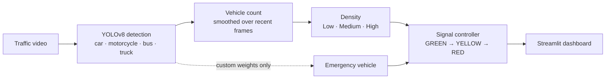

# 🚦 Smart Traffic Management System

[](https://github.com/pavanadityav-ai/smart-traffic-management/actions/workflows/tests.yml)


A Streamlit web app that counts vehicles in traffic video with **YOLOv8**, classifies traffic density, and drives an adaptive traffic-signal controller. It also includes an interactive signal simulator.

B.Tech team project (Computer Science and Engineering, AI & ML), Mohan Babu University. This repository is an improved and tested version of the original college project.

## What it does



| Page | What you can do |
|---|---|
| **Live Detection** | Upload a video, choose YOLOv8 n / s / m (or your own weights), and watch annotated frames, vehicle counts per type, density, the live traffic light, and FPS / inference-time charts |
| **Signal Simulator** | Add or remove vehicles, spawn an emergency vehicle, and watch the same controller respond on an animated road (no video needed) |

## Signal timing rules

| Condition | 🟢 Green | 🟡 Yellow | 🔴 Red |
|---|---|---|---|
| Emergency vehicle | 90 s | 5 s | 10 s |
| High density (≥ 25 vehicles) | 60 s | 5 s | 25 s |
| Medium density (10–24) | 40 s | 5 s | 55 s |
| Low density (< 10) | 20 s | 5 s | 95 s |

A running phase is never cut short by a density change; the new timing applies when the next phase starts. An emergency switches to green immediately, once per emergency event.

## Improvements in this version

| # | Change | Why it matters |
|---|---|---|
| 1 | **The signal runs on video time** (frame number ÷ frames per second) instead of the computer's clock | The original timing depended on how fast the computer processed frames. Now a 20-second green lasts 20 seconds of video on any machine. |
| 2 | **Count smoothing** (median of the last N frames, adjustable) | A single frame can miss or double-count a vehicle. Smoothing stops the density level flickering between Low and Medium. |
| 3 | **Counts per vehicle type** (car, motorcycle, bus, truck) | More useful output than one total. |
| 4 | **Honest emergency status** | The standard YOLOv8 (COCO) models have no ambulance, fire truck or police class. The app now says emergency detection is off for these models instead of showing ✅. |
| 5 | **Custom weights really load** from `models/` | The original README described this, but the model menu only listed n / s / m. |
| 6 | **Correct real-time check with frame skipping** | Processing every 3rd frame only needs one third of the video's frame rate. |
| 7 | **Simulator fixes** | Cars already past the stop line no longer freeze on red, emergency vehicles pass the red light, and exactly one ambulance appears per emergency. |
| 8 | **19 unit tests + GitHub Actions** | Density rules, smoothing and every controller transition are tested on each push. The controller takes the time as an input, which makes exact tests possible. |

## Limitations (and what I would do next)

- **No emergency detection with standard weights.** Next step: fine-tune YOLOv8 on a labelled ambulance / fire truck dataset and place the weights in `models/`.
- **Counts vehicles per frame, not unique vehicles.** Adding tracking (for example ByteTrack, built into Ultralytics) would count each vehicle once as it passes.
- **Fixed density thresholds.** The right numbers depend on the camera angle and road size.
- **Detection accuracy is not measured** on a labelled traffic dataset; the app reports speed (FPS, inference time) only.
- **Rule-based timing.** Reinforcement learning across several junctions is a possible extension.

## How to run

Requires Python 3.10+.

```bash
pip install -r requirements.txt
streamlit run app.py
```

Open the address shown in the terminal (usually http://localhost:8501). YOLOv8 weights download automatically on first use. `yolov8n` runs on a normal laptop CPU; `yolov8m` is slower without a GPU.

**Custom model:** put a `.pt` file (for example one trained with ambulance, fire truck and police classes) in `models/`. It appears in the model menu, and emergency detection switches on automatically.

**Tests** (no GPU, video, Streamlit or YOLO needed):

```bash
pip install pytest
python -m pytest -q
```

## Project structure

```
app.py                       home page
pages/1_Live_Detection.py    video analysis with YOLOv8
pages/2_Signal_Simulator.py  interactive simulation (Python logic + JavaScript canvas)
utils/detection.py           YOLOv8 wrapper: counts per type, emergency classes, model list
utils/density.py             density levels and count smoothing
utils/control.py             timing rules and the signal state machine
tests/test_logic.py          unit tests
models/                      optional custom weights (.pt files are not committed)
```

## Credits

Team project at Mohan Babu University. My role in the original project: I wrote the project specification for the team (features, algorithms and tech stack), and built and tested parts of the app using AI tools. The improvements and tests in this version were written with AI assistance (Claude).

Built with [Ultralytics YOLOv8](https://github.com/ultralytics/ultralytics), OpenCV and Streamlit.
