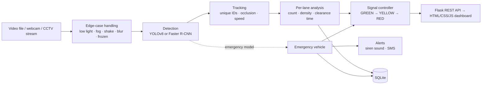
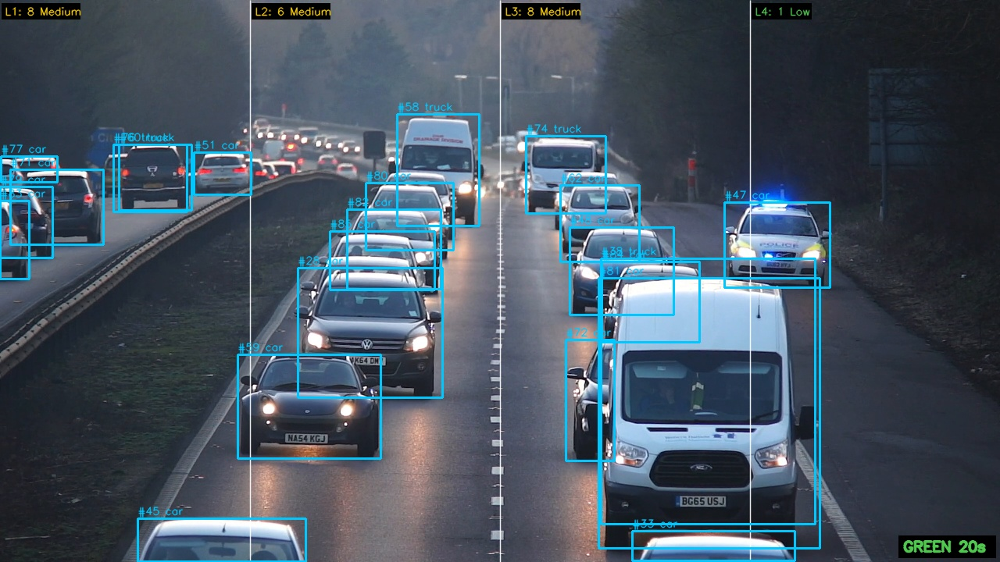
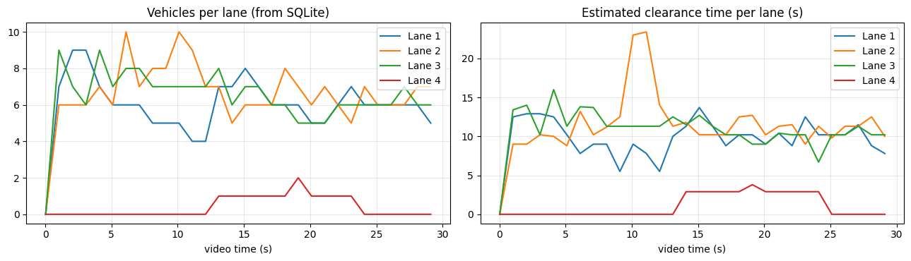

# 🚦 Advanced Intelligent System for Efficient and Smart Traffic Management

[](https://github.com/pavanadityav-ai/smart-traffic-management/actions/workflows/tests.yml)


A web system that watches traffic video, counts vehicles **per lane**, classifies traffic density, estimates **road clearance time**, and sets **adaptive signal timing**, with priority and alerts for emergency vehicles. All data is stored in a database for later analysis, and YOLOv8 is compared with Faster R-CNN on accuracy and speed.

**About this project.** It started as our B.Tech team project at Mohan Babu University (Computer Science and Engineering, AI & ML). I wrote the project specification: features, algorithms and tech stack. The team built a first Streamlit prototype that covered part of it. This repository is **my extended version**, which implements the full specification, with automated tests. The earlier prototype is in the commit history.

## How it works



## Specification and implementation

| Feature (from my specification) | Implementation | Code |
|---|---|---|
| Vehicle detection and counting | YOLOv8 (n/s/m) or Faster R-CNN; car, motorcycle, bus, truck; a tracker counts each vehicle once | `traffic/detection.py`, `traffic/tracking.py` |
| Density classification per lane | Low / Medium / High / Very High from the vehicle count in each lane (thresholds adjustable) | `traffic/analysis.py` |
| Road clearance time | Queue length (weighted by vehicle type) ÷ average speed, plus start-up time; speed measured from tracks when the camera is calibrated | `traffic/analysis.py` |
| Emergency vehicle detection | A second YOLOv8 model trained on ambulance / fire truck / police images runs alongside the main model | `traffic/detection.py`, `notebooks/train_emergency_detector.ipynb` |
| Emergency alert notification | Siren sound in the dashboard; SMS through Twilio (optional); 30 s cooldown | `traffic/alerts.py` |
| Traffic signal optimisation | Green time = clearance time, kept between a density minimum and 90 s; emergency → green at once | `traffic/signal.py` |
| Accuracy comparison (YOLOv8 vs R-CNN) | mAP@0.5, mAP@0.5:0.95, AP per vehicle type, FPS and inference time on COCO val2017 vehicles, with charts | `benchmark/compare_models.py`, `notebooks/benchmark_on_kaggle.ipynb` |
| Data storage and analysis | SQLite: runs, per-lane data every second, emergency log; History page with charts and CSV export | `traffic/storage.py` |
| Edge cases | Low light, fog / rain, camera shake, blur, frozen camera, occlusion (details below) | `traffic/preprocess.py`, `traffic/tracking.py` |
| Front end and back end | HTML, CSS, JavaScript (Chart.js) on a Flask REST API | `app.py`, `templates/`, `static/` |

## The rules in numbers

**Density per lane:** Low < 5 vehicles · Medium 5–9 · High 10–14 · Very High ≥ 15. The count is the median of the last 15 frames, so one bad frame does not change the level.

**Road clearance time** (per lane; lanes clear in parallel, so the slowest lane decides):

```
load       = sum of vehicle weights      car 1 · motorcycle 0.5 · bus 2 · truck 2
clearance  = 2 s start-up + load × 7 m ÷ speed
speed      = measured average speed of moving vehicles (if metres-per-pixel is set),
             otherwise a typical speed for the density level (8 / 6 / 4 / 3 m/s)
```

**Signal timing:** green = clearance time, at least 15 / 25 / 40 / 55 s for Low / Medium / High / Very High, at most 90 s. Red = 120 s cycle − green − 5 s yellow (at least 10 s). A running phase is never cut short; new timing applies from the next phase. **Emergency:** green immediately for 90 s, once per emergency.

These are simple, explainable models with adjustable values in `traffic/config.py`. They are estimates, not traffic-engineering predictions.

## Edge cases

| Problem | What the system does |
|---|---|
| Low light (night) | Detects and flags low brightness. Optional contrast enhancement (CLAHE + gamma), off by default because the benchmark showed it did not improve detection (see Results) |
| Fog, rain, haze | Detects and flags low contrast; the same optional enhancement |
| Camera shake | Tracks image points with optical flow; if the whole image moves, the shift is smoothed out. If many points stay still, only vehicles moved, so traffic is not mistaken for shake |
| Occlusion | The tracker keeps a hidden vehicle for 15 frames, so it stays in the queue count and is not counted twice when it reappears |
| Blurry frame | Flagged (Laplacian variance), so you know the counts are less reliable |
| Frozen camera | Flagged when the identical frame repeats for 30 frames |

Every condition is shown on the dashboard and stored with the data.

## Results

### Demo on a real highway video



*The full pipeline with YOLOv8s on a public highway video ([Traffic Flow In The Highway](https://www.pexels.com/video/traffic-flow-in-the-highway-2103099/), Pexels), resized to 1280×720 and split into 4 lanes. Boxes are tracked vehicles with their IDs; the top labels show each lane's count and density; the signal state is bottom right. Made with [`notebooks/demo_on_kaggle.ipynb`](notebooks/demo_on_kaggle.ipynb).*

- **30 seconds of video (900 frames):** 122 vehicle tracks (97 cars, 22 trucks, 3 buses; a few may be double-counted when the tracker loses a car). Lanes 1 to 3 held about 6 vehicles on average, so density was **Medium** most of the time, with an estimated clearance time of about 10 to 11 seconds per lane.
- **Speed:** on Kaggle's CPU, YOLOv8s took about 227 ms per frame (about 4 FPS). Live use on a CPU therefore needs YOLOv8n or frame skipping; on a T4 GPU, YOLOv8s runs at 74 FPS (benchmark below).
- **Limits you can see in the picture:** the police car with blue lights is labelled only "car", because the standard model has no emergency class (this is why the separate emergency model exists). Vans are often labelled "truck". Equal vertical lanes do not follow the road's perspective, and lane 4 is mostly the hard shoulder.



### YOLOv8 vs Faster R-CNN

500 COCO val2017 images that contain vehicles, official COCO evaluation, Tesla T4 GPU ([`benchmark/compare_models.py`](benchmark/compare_models.py), raw numbers in [`results/benchmark.json`](results/benchmark.json)).

| Model | mAP@0.5 | mAP@0.5:0.95 | FPS | ms / image | Parameters |
|---|---|---|---|---|---|
| YOLOv8n | 0.616 | 0.416 | 95.6 | 10.5 | 3.2 M |
| YOLOv8s | 0.681 | 0.482 | 74.3 | 13.5 | 11.2 M |
| YOLOv8m | 0.723 | 0.529 | 31.9 | 31.4 | 25.9 M |
| Faster R-CNN (R50-FPN v2) | **0.788** | **0.544** | 4.2 | 239.0 | 43.7 M |

AP@0.5:0.95 per vehicle type:

| Model | Car | Motorcycle | Bus | Truck |
|---|---|---|---|---|
| YOLOv8n | 0.379 | 0.426 | 0.592 | 0.266 |
| YOLOv8s | 0.447 | 0.486 | 0.662 | 0.332 |
| YOLOv8m | 0.494 | 0.539 | 0.693 | 0.391 |
| Faster R-CNN | 0.508 | 0.522 | 0.708 | 0.440 |

What this shows:

- **Faster R-CNN is the most accurate, but too slow for live video:** 4 FPS on a T4, while a camera sends 25–30 frames per second.
- **YOLOv8m is the best balance for a junction camera:** 92% of Faster R-CNN's mAP@0.5 at 7.6 times the speed. **YOLOv8n** is three times faster again, which suits a CPU or an edge device, at lower accuracy.
- **Trucks are the hardest class for every model**, buses the easiest. (Trucks vary a lot in shape and size, which is a likely reason.)

### Low-light test

The same 500 images, darkened to simulate night, without and with the app's low-light enhancement (CLAHE + gamma). mAP@0.5:

| Model | Normal | Dark | Dark + enhancement |
|---|---|---|---|
| YOLOv8n | 0.616 | 0.537 | 0.505 |
| YOLOv8s | 0.681 | 0.602 | 0.577 |
| YOLOv8m | 0.723 | 0.674 | 0.665 |
| Faster R-CNN | 0.788 | 0.701 | 0.707 |

**Finding:** darkness lowered accuracy by 5 to 9 points, and the enhancement **did not help**. It made YOLOv8 slightly worse and helped Faster R-CNN by less than one point. So the app still detects and flags low light, but the enhancement is now **off by default** (it can be switched on in the dashboard). A better fix would be training on real night-time images.

## REST API

| Method | Endpoint | Purpose |
|---|---|---|
| GET | `/api/models` | Available detectors, emergency models, SMS status |
| POST | `/api/jobs` | Start analysing an uploaded video, webcam number or stream URL (RTSP/HTTP) |
| GET | `/api/jobs/<id>` | Live state: per-lane counts, density, clearance, signal, alerts, image-quality flags |
| GET | `/api/jobs/<id>/stream` | Annotated video (MJPEG) |
| POST | `/api/jobs/<id>/stop` | Stop a job |
| GET | `/api/runs`, `/api/runs/<id>` | Stored runs, summary and emergency log |
| GET | `/api/runs/<id>/history`, `/api/runs/<id>/export.csv` | Per-second, per-lane data (JSON / CSV) |
| GET | `/api/benchmark` | Model comparison results |

## How to run

Requires Python 3.10+.

```bash
pip install -r requirements.txt
python app.py
```

Open http://127.0.0.1:5000, upload a traffic video (or enter `0` for a webcam, or an RTSP address), and press **Start**. YOLOv8 weights download automatically on first use. `yolov8n` runs on a normal laptop CPU; Faster R-CNN is much slower without a GPU.

**SMS alerts (optional):** set `TWILIO_ACCOUNT_SID`, `TWILIO_AUTH_TOKEN`, `TWILIO_FROM_NUMBER` and `ALERT_TO_NUMBER` before starting the app. Without them, alerts are sound-only.

**Tests** (58 tests; no GPU, video or YOLO needed, a fake detector is used):

```bash
pip install pytest
python -m pytest -q
```

## Deployment (planned)

The same Flask app can run on a local PC, on a cloud server reading the junction's RTSP camera stream, or on an edge device such as a Raspberry Pi next to the camera (with `yolov8n` and frame skipping). Only the local setup has been tested.

## Project structure

```
app.py                         Flask app: pages and REST API
traffic/config.py              all thresholds, timings and weights
traffic/detection.py           YOLOv8, Faster R-CNN and the combined emergency detector
traffic/tracking.py            IoU tracker: unique counts, occlusion, speed
traffic/analysis.py            lanes, density, clearance time
traffic/signal.py              signal timing and state machine
traffic/preprocess.py          edge-case handling
traffic/alerts.py              siren and SMS alerts
traffic/storage.py             SQLite database
traffic/pipeline.py            per-frame pipeline and background job
templates/, static/            dashboard, history and comparison pages (HTML, CSS, JS)
benchmark/compare_models.py    YOLOv8 vs Faster R-CNN benchmark
notebooks/                     Kaggle notebooks: benchmark, emergency-model training
tests/                         unit and system tests
```

## Limitations

- Lanes are equal vertical strips of the frame; a real junction needs lane shapes drawn for its camera.
- Speed is measured only after calibration (metres per pixel); otherwise typical speeds are used.
- The signal logic controls one approach; coordinating a full junction (or several) is a next step, for example with reinforcement learning.
- Emergency detection depends on the training dataset; sirens and flashing lights are not used.

## Credits

Original team project at Mohan Babu University; I wrote the specification and built and tested parts of the first version using AI tools. This extended version was written with AI assistance (Claude).

Built with [Ultralytics YOLOv8](https://github.com/ultralytics/ultralytics), [torchvision](https://pytorch.org/vision/) Faster R-CNN, OpenCV, Flask and Chart.js.
